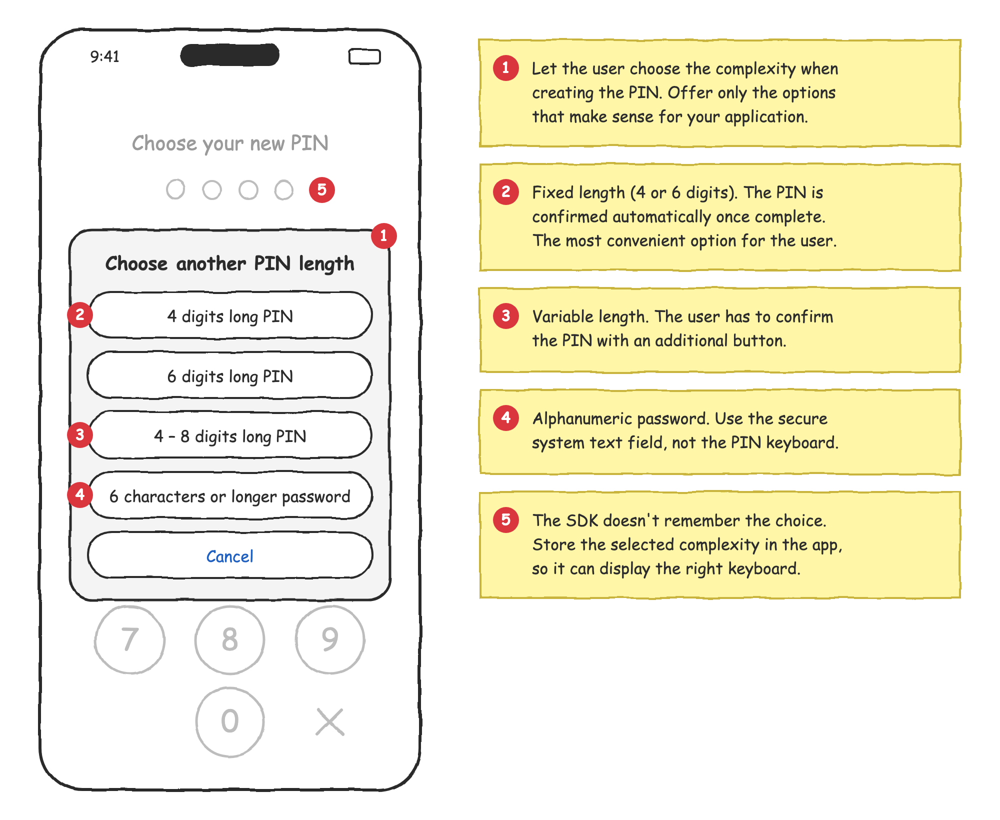
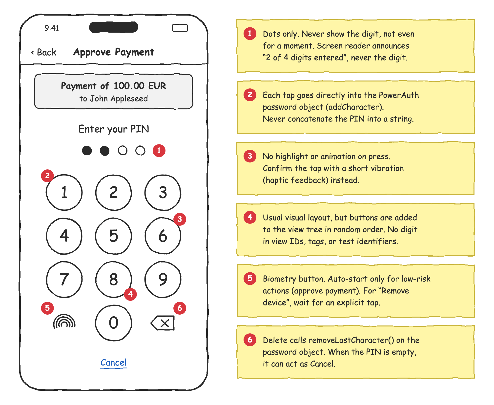
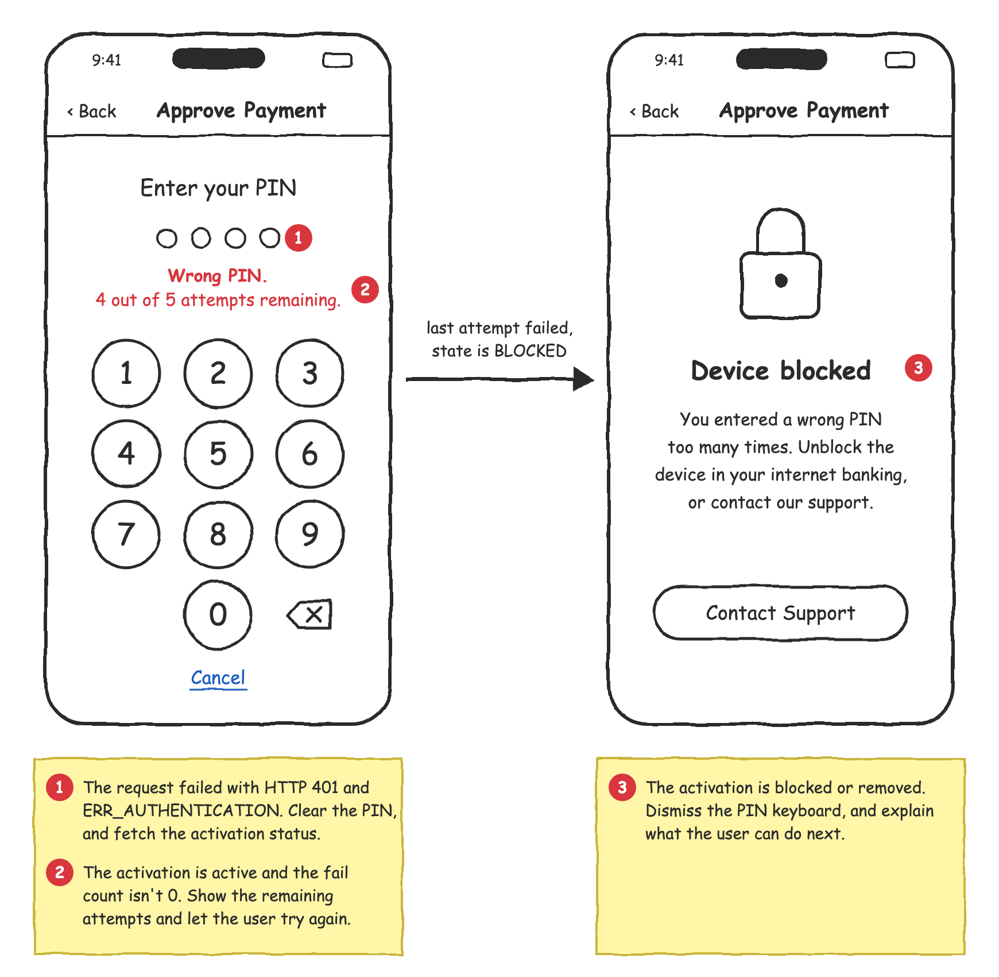
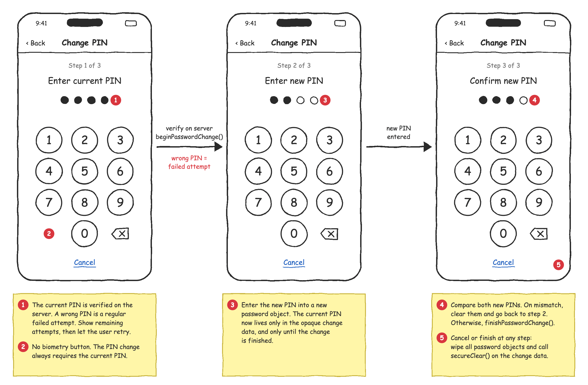

# Implementing Secure PIN Keyboard

The user's PIN or password is the knowledge factor in PowerAuth. It's one of the most sensitive pieces of information in your application. This tutorial explains how to collect it securely, from the moment the user taps a key to the moment the SDK uses it for a cryptographic operation.

<!-- begin box info -->
PowerAuth Mobile SDK doesn't provide any user interface for entering the PIN or password. The PIN keyboard is a highly personalized part of the user experience, and it has to match the look and feel of your application. It's up to you, as the integrator, to implement it. This tutorial helps you do it securely.
<!-- end -->

PowerAuth **never stores the user's password anywhere**. It isn't stored on the device, and it isn't stored on the server. In fact, the password never leaves the device at all. The SDK uses it only to derive a key that unlocks the knowledge factor key, which is stored encrypted on the device. The server then verifies the resulting authentication code. If the user enters a wrong PIN, the authentication code is invalid, the server counts a failed attempt, and it blocks the activation once the maximum number of failed attempts is reached. As a result, there's nothing to steal from the device storage, from a backup, or from the server database.

The only place where the password exists is the application memory, and only while the user enters it. PowerAuth treats this memory with the same care. The SDK keeps the password scrambled with random data, reveals it in plaintext only for the short moment it's needed for the cryptography, and wipes it out once it's no longer needed. A memory dump of your application should never expose the user's password.

However, the SDK can protect only what it receives. If your application collects the PIN into a string and only then passes it to the SDK, copies of the PIN stay in memory outside of the SDK's control. This tutorial shows you how to avoid that.

<!-- begin box info -->
This tutorial builds on the platform-specific documentation. For the full API description, see [Working with Passwords Securely on iOS](ios/Working-With-Passwords-Securely.md) and [Working with Passwords Securely on Android](android/Working-With-Passwords-Securely.md).
<!-- end -->

## Table of Contents

- [Working With the Password Object](#working-with-the-password-object)
- [PIN Complexity and Strength](#pin-complexity-and-strength)
- [Entering Alphanumeric Password](#entering-alphanumeric-password)
- [PIN Length](#pin-length)
- [User Interface](#user-interface)
- [Handling Wrong PIN](#handling-wrong-pin)
- [Changing the PIN](#changing-the-pin)
- [Reacting on Application Lifecycle](#reacting-on-application-lifecycle)

## Working With the Password Object

Strings in managed environments, such as Swift, Objective-C, Java, or Kotlin, are immutable. Every concatenation creates a new copy of the string, and the old copy is not wiped out when it's released. The memory allocator only marks the memory as free, so the content stays in memory until the same region is reused. That may take minutes, hours, or even days. Moreover, you can't wipe the content of a string on your own, because the runtime doesn't give you access to its buffer.

<!-- begin box warning -->
That's why you should **never work with the complete password as a string**. Instead, work with individual characters, more precisely with Unicode code points, and pass them directly into the PowerAuth password object.
<!-- end -->

The following table shows the password object API on both platforms:

| Task | iOS | Android |
|------|-----|---------|
| Object for entering the password | `PowerAuthMutablePassword` | `Password()` (constructor without parameters) |
| Immutable password | `PowerAuthPassword` | `Password(String)`, `Password(ByteArray)` |
| Add a character | `addCharacter(_:)` | `addCharacter(codePoint)` |
| Remove the last character | `removeLastCharacter()` | `removeLastCharacter()` |
| Wipe the content | `clear()` | `clear()` |
| Create an immutable copy | `copyToImmutable()` | `copyToImmutable()` |
| Destroy the object | Release the last reference | `destroy()` |

The following example shows the basic work with the mutable password object:

<!-- begin codetabs Android iOS -->
```kotlin
// Create an empty, mutable password object.
val pin = Password()

// Add characters one by one, as Unicode code points.
pin.addCharacter(0x31)                  // "1"
pin.addCharacter(0x30 + 2)              // "2", digit converted to its code point

// Arbitrary character, converted to code point.
val character = 'a'
pin.addCharacter(character.code)

// Remove the last character, or wipe the whole content.
pin.removeLastCharacter()
pin.clear()

// Destroy the object once you no longer need it. The memory is wiped out on destroy.
// Calling destroy() explicitly is safer than relying on the garbage collector,
// because you can't predict when the garbage collector releases the object.
pin.destroy()
```
```swift
// Create an empty, mutable password object.
let pin = PowerAuthMutablePassword()

// Add characters one by one, as Unicode code points.
pin.addCharacter(0x31)                  // "1"
pin.addCharacter(UInt32(0x30 + 2))      // "2", digit converted to its code point

// Arbitrary character, converted to code points.
let character: Character = "a"
for scalar in character.unicodeScalars {
    pin.addCharacter(scalar.value)
}

// Remove the last character, or wipe the whole content.
pin.removeLastCharacter()
pin.clear()

// Once the last reference to the object is released (ARC reference count drops to 0),
// the object is destroyed and its memory is wiped out automatically.
```
<!-- end -->

### Keep the Password in Memory Only When Necessary

When the password object is destroyed, it wipes out its memory, so no traces of the password are left behind. It's therefore important to keep the object alive only for as long as it's really needed:

- On iOS, the object is destroyed as soon as you release the last reference to it. Don't keep any other references to it.
- On Android, the garbage collector destroys the object eventually, but you can't predict when. Call `destroy()` explicitly as soon as you no longer need the object. Note that you can't use the object after it's destroyed.

Follow these rules in your application:

- Create the password object when the PIN screen appears, and destroy it when the screen disappears.
- Don't keep the password object in long-lived objects, such as singletons, caches, or view models that outlive the screen.
- Never serialize the password. Don't put it into saved instance state, `Codable` or `Parcelable` objects, or logs.
- Pass an immutable copy (`copyToImmutable()`) to the SDK. This way, you can safely clear the mutable PIN, for example, after a failed attempt, without affecting the running operation.
- On Android, destroy the immutable copy only after the SDK finishes the operation that uses it.

An example of the password lifecycle:

<!-- begin codetabs Android iOS -->
```kotlin
class EnterPinFragment : Fragment() {

    private var pin: Password? = null

    override fun onStart() {
        super.onStart()
        // Create the password object when the screen appears.
        pin = Password()
    }

    override fun onStop() {
        super.onStop()
        // Wipe and destroy the password when the screen disappears.
        pin?.destroy()
        pin = null
    }

    private fun confirm() {
        val pin = pin ?: return
        // The authentication object keeps its own immutable copy of the PIN.
        val pinCopy = pin.copyToImmutable()
        val authentication = PowerAuthAuthentication.possessionWithPassword(pinCopy)
        pin.clear()
        // Use the authentication object, for example, to approve an operation,
        // and destroy pinCopy once the operation is finished.
    }
}
```
```swift
final class EnterPinViewController: UIViewController {

    private var pin: PowerAuthMutablePassword?

    override func viewWillAppear(_ animated: Bool) {
        super.viewWillAppear(animated)
        // Create the password object when the screen appears.
        pin = PowerAuthMutablePassword()
    }

    override func viewDidDisappear(_ animated: Bool) {
        super.viewDidDisappear(animated)
        // Wipe and release the password when the screen disappears.
        pin?.clear()
        pin = nil
    }

    private func confirm() {
        guard let pin else { return }
        // The authentication object keeps its own immutable copy of the PIN.
        let authentication = PowerAuthAuthentication.possessionWithPassword(password: pin.copyToImmutable())
        pin.clear()
        // Use the authentication object, for example, to approve an operation...
    }
}
```
<!-- end -->

<!-- begin box warning -->
Don't build a string from the entered digits and then create the password object with `PowerAuthPassword(string:)` or `Password(String)`. Once the string exists, the damage is already done, because the PIN stays in memory regardless of what you do with the string later.
<!-- end -->

## PIN Complexity and Strength

The password object doesn't care about the length or the format of the password. It accepts any sequence of characters, so it's up to your application to decide what kind of PIN or password the user can use, and to enforce these rules.

The SDK also doesn't provide any facility to remember which complexity the user chose. If your application lets the user choose, store the choice in your application settings, so you can display the right keyboard next time, with the right number of dots and the right confirmation behavior. The stored information reveals only the format, never the PIN itself.

### Choosing the Complexity

The most common options are:

| Complexity | Input | Confirmation |
|------------|-------|--------------|
| Fixed 4-digit PIN | PIN keyboard | Automatic, once the PIN is complete |
| Fixed 6-digit PIN | PIN keyboard | Automatic, once the PIN is complete |
| Variable PIN, 4 to 8 digits | PIN keyboard | Confirmation button |
| Alphanumeric password | Secure system text field | Confirmation button |

By default, the user has 5 attempts to enter the PIN, and the activation is blocked after the last failed attempt. The limit is configured on the server. Because the PIN is always verified on the server, an attacker can't try all combinations offline. That's why even a 4-digit PIN provides reasonable protection: an attacker has only 5 attempts out of 10,000 combinations. Longer PINs obviously strengthen the security further, but they're harder to remember and slower to type. Consider the user experience and comfort as well, especially if your users authenticate several times a day.

The following mockup shows a screen where the user chooses the complexity when creating a new PIN:

<p align="center"></p>

### Checking the Strength

The SDK itself doesn't warn in any way if the user enters a weak PIN or password. It's up to your application to check the strength, and to decide whether to only warn the user, or to reject the PIN completely.

## Entering Alphanumeric Password

Sometimes, your application requires the user to enter a regular alphanumeric password instead of a PIN. Implementing a fully custom alphanumeric keyboard is very difficult, and it usually leads to bad user experience. It's acceptable to use the system keyboard in this case, but you need to configure the text field properly.

### Configure the Text Field

Always use a text field configured for password entry. Such a field hides the entered text, disables autocorrection, suggestions, and keyboard learning, and on iOS, it also forces the system keyboard.

<!-- begin box warning -->
Never allow a custom (third-party) keyboard to be used for entering the password. A custom keyboard is an application on its own, and it may record everything the user types.
<!-- end -->

<!-- begin box warning -->
Never allow the user to reveal the entered password, so don't implement any "show password" button. Once the password is revealed, the secure text entry is disabled. The password is then visible to anyone who observes the screen, it's captured in screenshots and screen recordings, and on iOS, custom keyboards are no longer blocked by the system.
<!-- end -->

Configure the password text field according to the UI framework you use:

<!-- begin codetabs Android-Views Android-Compose iOS-UIKit iOS-SwiftUI -->
```xml
<!--
  Use EditText with the password input type, and request the keyboard
  not to learn from the input.
-->
<EditText
    android:id="@+id/password"
    android:layout_width="match_parent"
    android:layout_height="wrap_content"
    android:inputType="textPassword"
    android:imeOptions="actionDone|flagNoPersonalizedLearning"
    android:importantForAutofill="no" />
```
```kotlin
// Use SecureTextField (or OutlinedSecureTextField) from Material 3, or BasicSecureTextField
// from Compose Foundation. By default, these fields briefly reveal the last typed character,
// so set the obfuscation mode to Hidden.
val passwordState = rememberTextFieldState()

SecureTextField(
    state = passwordState,
    label = { Text("Password") },
    textObfuscationMode = TextObfuscationMode.Hidden,
    keyboardOptions = KeyboardOptions(
        keyboardType = KeyboardType.Password,
        autoCorrectEnabled = false,
    ),
)
```
```swift
// Use UITextField with secure text entry enabled. Don't use UITextView,
// because it's not designed for secure text entry.
passwordField.isSecureTextEntry = true
passwordField.textContentType = .password
passwordField.autocorrectionType = .no
passwordField.spellCheckingType = .no
passwordField.autocapitalizationType = .none
passwordField.smartInsertDeleteType = .no
```
```swift
// Use SecureField.
//
// Note that SecureField always binds the entered text to a String. Keep the bound state
// local to the view, create the password object as soon as the user confirms the password,
// and reset the state right after that. If you need full control over the entered characters,
// wrap UITextField in UIViewRepresentable and use the approach described in the
// "Avoid Working With the Text as a String" chapter.
SecureField("Password", text: $password)
    .textContentType(.password)
    .textInputAutocapitalization(.never)
    .autocorrectionDisabled()
    .privacySensitive()
```
<!-- end -->

Then, make sure that no custom keyboard is used for entering the password:

<!-- begin codetabs Android iOS -->
```kotlin
// Unlike iOS, Android doesn't allow an application to block custom keyboards. The password
// input type and the flagNoPersonalizedLearning option only ask the keyboard not to learn
// from the input, but a malicious keyboard can simply ignore them.
//
// If you want to mitigate this risk, you can check whether the current keyboard
// is a system keyboard, and warn the user if it's not.
fun isSystemKeyboardActive(context: Context): Boolean {
    val keyboardId = Settings.Secure.getString(context.contentResolver, Settings.Secure.DEFAULT_INPUT_METHOD)
        ?: return false
    val inputMethodManager = context.getSystemService(InputMethodManager::class.java)
    val keyboard = inputMethodManager.enabledInputMethodList.firstOrNull { it.id == keyboardId }
        ?: return false
    return (keyboard.serviceInfo.applicationInfo.flags and ApplicationInfo.FLAG_SYSTEM) != 0
}
```
```swift
// iOS automatically replaces custom keyboards with the system keyboard in secure text fields.
// To make sure that no custom keyboard is used anywhere in your application, for example,
// in a text field that is not configured properly, disable custom keyboards in the whole
// application in your application delegate.
//
// In a SwiftUI application, attach the application delegate with @UIApplicationDelegateAdaptor.
func application(_ application: UIApplication,
                 shouldAllowExtensionPointIdentifier extensionPointIdentifier: UIApplication.ExtensionPointIdentifier) -> Bool {
    // Disable custom (third-party) keyboards in the whole application.
    return extensionPointIdentifier != .keyboard
}
```
<!-- end -->

For more complex protection against malicious applications, see [Mobile Runtime Security](Runtime-Security.md).

### Avoid Working With the Text as a String

Even with the system keyboard, try to avoid reading the complete text from the text field as a string.

On Android, `EditText.getText()` returns `Editable`, which is a `CharSequence`. You can read the characters directly from it without calling `toString()`, and then clear the text field:

```kotlin
fun Editable.toPowerAuthPassword(): Password {
    val password = Password()
    var index = 0
    while (index < length) {
        // Read the code point directly from the Editable, without creating a String.
        val codePoint = Character.codePointAt(this, index)
        password.addCharacter(codePoint)
        index += Character.charCount(codePoint)
    }
    // Remove the password from the text field.
    clear()
    return password
}

// Usage
val password = binding.passwordField.text.toPowerAuthPassword()
```

The same approach works with Jetpack Compose, because `TextFieldState.text` is also a `CharSequence`. Call `TextFieldState.clearText()` once you create the password object.

On iOS, `UITextField.text` always returns a new `String`. To avoid it, you can intercept every change in the text field delegate, apply it to the mutable password object, and let the text field display only placeholder characters:

```swift
final class SecurePasswordFieldDelegate: NSObject, UITextFieldDelegate {

    let password = PowerAuthMutablePassword()

    func textField(_ textField: UITextField,
                   shouldChangeCharactersIn range: NSRange,
                   replacementString string: String) -> Bool {
        // The text field contains one placeholder per password character,
        // so the range directly maps to the character indexes in the password object.
        for _ in 0..<range.length {
            password.removeCharacter(at: UInt(range.location))
        }
        var index = UInt(range.location)
        for scalar in string.unicodeScalars {
            password.insertCharacter(scalar.value, at: index)
            index += 1
        }
        // Display only placeholders. The real characters never get into the text field.
        textField.text = String(repeating: "•", count: Int(password.length()))
        if let position = textField.position(from: textField.beginningOfDocument, offset: Int(index)) {
            textField.selectedTextRange = textField.textRange(from: position, to: position)
        }
        return false
    }
}
```

Treat this example as a starting point. Test it carefully with your application, including pasting, password autofill, and dictation.

<!-- begin box info -->
These techniques minimize the copies of the password in your application. The system keyboard and the text input system still process the entered characters, which is outside of your application's control. That's one of the reasons why a custom PIN keyboard is the preferred way of entering the knowledge factor.
<!-- end -->

## PIN Length

There are two approaches to the PIN length, and each has an impact on the user experience:

- **Fixed length** (for example, exactly 4 or 6 digits). The application knows when the PIN is complete, so it can confirm it automatically once the user enters the last digit. This is the simplest and fastest experience for the user.
- **Variable length** (for example, 4 to 8 digits). The application can't know when the user is finished, so the user has to confirm the PIN with an additional button. This adds complexity to your UI, because you need to enable the confirmation button only when the minimum length is reached. Users also often perceive the additional tap as nagging, especially when they authenticate several times a day.

We recommend using a fixed PIN length, unless you have a good reason for the variable one. For example, when you need to support existing PINs of different lengths.

An example of handling both approaches:

<!-- begin codetabs Android iOS -->
```kotlin
data class PinLengthPolicy(val minLength: Int, val maxLength: Int) {
    val isFixed: Boolean get() = minLength == maxLength
}

fun onDigit(digit: Int) {
    val pin = pin ?: return
    if (pin.length() >= policy.maxLength) return
    pin.addCharacter(0x30 + digit)
    if (policy.isFixed) {
        // Fixed length, confirm automatically once the PIN is complete.
        if (pin.length() == policy.maxLength) {
            confirm()
        }
    } else {
        // Variable length, the user has to confirm the PIN.
        confirmButton.isEnabled = pin.length() >= policy.minLength
    }
}
```
```swift
struct PinLengthPolicy {
    let minLength: Int
    let maxLength: Int
    var isFixed: Bool { minLength == maxLength }
}

func onDigit(_ digit: Int) {
    guard let pin, pin.length() < policy.maxLength else { return }
    pin.addCharacter(UInt32(0x30 + digit))
    if policy.isFixed {
        // Fixed length, confirm automatically once the PIN is complete.
        if pin.length() == policy.maxLength {
            confirm()
        }
    } else {
        // Variable length, the user has to confirm the PIN.
        confirmButton.isEnabled = pin.length() >= policy.minLength
    }
}
```
<!-- end -->

When you confirm the PIN automatically, ignore any further input until the operation finishes, so the extra taps don't leak into the next attempt. If the authentication fails, clear the PIN and let the user try again.

## User Interface

The following mockup shows the recommended PIN keyboard. The numbered notes explain the important details, which are described in the rest of this chapter.

<p align="center"></p>

### Entering Digits

After the user taps a digit, add it to the PowerAuth password object immediately. Never collect the digits into a string, an array, or any other temporary storage. For the delete button, use the password object API (`removeLastCharacter()`) as well. You can also use the delete button as a cancel button when the PIN is empty.

Don't determine the digit by reading the button's title. Instead, keep your own mapping between the button and the digit, as shown in the examples below.

### No Visual Feedback

Don't highlight or animate the keys when the user presses them. If a key changes its appearance when pressed, anyone who observes the screen, or a screen recording, can read the PIN. Without any visual feedback, the only visible change is the number of filled dots, which doesn't reveal the digits.

Give the user haptic feedback (a short vibration) instead, so the user knows the tap was registered. Also, never display the entered digit, not even for a short moment.

<!-- begin box info -->
The tips about the visual and haptic feedback are optional. Removing the visual feedback improves security, but it may affect the user experience, because some users may feel unsure whether their tap was registered. Consider them in the context of the overall UX of your application, and find the right balance between security and usability.
<!-- end -->

<!-- begin box warning -->
Never allow the user to reveal the entered PIN, so don't implement any "show PIN" button. The PIN indicator must always display only the dots, regardless of the user's preferences.
<!-- end -->

### Randomized View Tree

Keep the usual visual layout of the keyboard, because users rely on their muscle memory. However, add the keys to the view tree in random order, and position them on the screen based on the digit they represent. This way, the order of views doesn't reveal which key is which, and an attacker can't automate the keyboard by simply tapping, for example, "the first button is 1, the second button is 2", and so on. For the same reason, don't put digits into view IDs, tags, or test identifiers.

<!-- begin box info -->
For applications with very high security requirements, you can also shuffle the visual layout of the keys. This protects the PIN against shoulder surfing and tap-position logging, but it significantly slows the user down. Consider this trade-off carefully.
<!-- end -->

The following example shows a PIN keyboard. The keys are added to the view in random order, have no visual feedback, and produce haptic feedback instead. On Android, the keyboard is implemented as a custom `ViewGroup`, and the keys have no background, so there's no ripple effect when pressed. Note that the Android layout expects an exact size, for example, `match_parent` or a fixed size.

<!-- begin codetabs Android iOS -->
```kotlin
sealed interface PinKey {
    data class Digit(val value: Int) : PinKey
    data object Biometry : PinKey
    data object Delete : PinKey
}

/** Position of the key in the 3 × 4 grid, as (row, column). */
private val PinKey.position: Pair<Int, Int>
    get() = when (this) {
        is PinKey.Digit -> if (value == 0) 3 to 1 else (value - 1) / 3 to (value - 1) % 3
        PinKey.Biometry -> 3 to 0
        PinKey.Delete -> 3 to 2
    }

class PinKeyboardLayout @JvmOverloads constructor(
    context: Context,
    attrs: AttributeSet? = null,
) : ViewGroup(context, attrs) {

    var onKey: ((PinKey) -> Unit)? = null

    private val keys = mutableListOf<Pair<View, PinKey>>()

    init {
        val allKeys: List<PinKey> = (0..9).map { PinKey.Digit(it) } + listOf(PinKey.Biometry, PinKey.Delete)
        // Add the keys in random order, so the order of child views
        // doesn't reveal which key is which.
        for (key in allKeys.shuffled(SecureRandom())) {
            val view = createKeyView(key)
            keys += view to key
            addView(view)
        }
    }

    private fun createKeyView(key: PinKey): View = TextView(context).apply {
        // Never use IDs like R.id.key_1.
        id = View.generateViewId()
        gravity = Gravity.CENTER
        textSize = 32f
        // Use icons for the special keys in your application.
        text = when (key) {
            is PinKey.Digit -> key.value.toString()
            PinKey.Biometry -> "Bio"
            PinKey.Delete -> "⌫"
        }
        contentDescription = when (key) {
            is PinKey.Digit -> key.value.toString()
            PinKey.Biometry -> "Use biometry"
            PinKey.Delete -> "Delete"
        }
        // No background, so there's no ripple or other visual feedback.
        background = null
        isSoundEffectsEnabled = false
        // Ignore touches when another window covers the keyboard (tapjacking protection).
        filterTouchesWhenObscured = true
        setOnClickListener { view ->
            // No visual feedback, only a short vibration.
            view.performHapticFeedback(HapticFeedbackConstants.KEYBOARD_TAP)
            onKey?.invoke(key)
        }
    }

    override fun onMeasure(widthMeasureSpec: Int, heightMeasureSpec: Int) {
        val width = MeasureSpec.getSize(widthMeasureSpec)
        val height = MeasureSpec.getSize(heightMeasureSpec)
        val keyWidthSpec = MeasureSpec.makeMeasureSpec(width / 3, MeasureSpec.EXACTLY)
        val keyHeightSpec = MeasureSpec.makeMeasureSpec(height / 4, MeasureSpec.EXACTLY)
        keys.forEach { (view, _) -> view.measure(keyWidthSpec, keyHeightSpec) }
        setMeasuredDimension(width, height)
    }

    override fun onLayout(changed: Boolean, left: Int, top: Int, right: Int, bottom: Int) {
        // The position on the screen depends on the key, not on the order in the view tree.
        val keyWidth = (right - left) / 3
        val keyHeight = (bottom - top) / 4
        for ((view, key) in keys) {
            val (row, column) = key.position
            view.layout(column * keyWidth, row * keyHeight, (column + 1) * keyWidth, (row + 1) * keyHeight)
        }
    }
}
```
```swift
enum PinKey: Equatable {
    case digit(Int)
    case biometry
    case delete

    /// Position of the key in the 3 × 4 grid.
    var position: (row: Int, column: Int) {
        switch self {
        case .digit(0): return (3, 1)
        case .digit(let value): return ((value - 1) / 3, (value - 1) % 3)
        case .biometry: return (3, 0)
        case .delete: return (3, 2)
        }
    }
}

/// A key without any built-in highlight, so a press leaves no visual trace.
final class PinKeyView: UIControl {

    private let label = UILabel()

    init(title: String, accessibilityLabel: String) {
        super.init(frame: .zero)
        label.text = title
        label.font = .systemFont(ofSize: 32)
        label.textAlignment = .center
        addSubview(label)
        isAccessibilityElement = true
        self.accessibilityLabel = accessibilityLabel
        accessibilityTraits = .keyboardKey
    }

    required init?(coder: NSCoder) { fatalError("init(coder:) has not been implemented") }

    override func layoutSubviews() {
        super.layoutSubviews()
        label.frame = bounds
    }
}

final class PinKeyboardView: UIView {

    var onKey: ((PinKey) -> Void)?

    private var keys: [(view: PinKeyView, key: PinKey)] = []
    private let haptics = UIImpactFeedbackGenerator(style: .light)

    override init(frame: CGRect) {
        super.init(frame: frame)
        let allKeys: [PinKey] = (0...9).map { .digit($0) } + [.biometry, .delete]
        // Add the keys in random order, so the order of subviews
        // doesn't reveal which key is which.
        for key in allKeys.shuffled() {
            let view = makeKeyView(for: key)
            view.addAction(UIAction { [weak self] _ in self?.keyTapped(key) }, for: .touchUpInside)
            keys.append((view, key))
            addSubview(view)
        }
    }

    required init?(coder: NSCoder) { fatalError("init(coder:) has not been implemented") }

    override func layoutSubviews() {
        super.layoutSubviews()
        // The position on the screen depends on the key, not on the order in the view tree.
        let size = CGSize(width: bounds.width / 3, height: bounds.height / 4)
        for (view, key) in keys {
            let (row, column) = key.position
            view.frame = CGRect(x: CGFloat(column) * size.width, y: CGFloat(row) * size.height,
                                width: size.width, height: size.height)
        }
    }

    private func makeKeyView(for key: PinKey) -> PinKeyView {
        // Use icons for the special keys in your application.
        switch key {
        case .digit(let value): return PinKeyView(title: "\(value)", accessibilityLabel: "\(value)")
        case .biometry: return PinKeyView(title: "Bio", accessibilityLabel: "Use biometry")
        case .delete: return PinKeyView(title: "⌫", accessibilityLabel: "Delete")
        }
    }

    private func keyTapped(_ key: PinKey) {
        // No visual feedback, only a short vibration.
        haptics.impactOccurred()
        onKey?(key)
    }
}
```
<!-- end -->

The screen controller then connects the keyboard to the password object:

<!-- begin codetabs Android iOS -->
```kotlin
keyboard.onKey = { key ->
    when (key) {
        is PinKey.Digit -> onDigit(key.value)       // See the PIN Length chapter
        PinKey.Delete -> pin?.removeLastCharacter()
        PinKey.Biometry -> startBiometry()
    }
    updatePinIndicator()
}
```
```swift
keyboard.onKey = { [weak self] key in
    guard let self else { return }
    switch key {
    case .digit(let digit): onDigit(digit)          // See the PIN Length chapter
    case .delete: pin?.removeLastCharacter()
    case .biometry: startBiometry()
    }
    updatePinIndicator()
}
```
<!-- end -->

Also consider protecting the PIN screen against screenshots and screen recording. On Android, set `WindowManager.LayoutParams.FLAG_SECURE` on the window. On iOS, there's no public API that prevents screen capture, but you can detect it with `UIScreen.isCaptured` (or `UITraitCollection.sceneCaptureState` on iOS 17 and newer) and hide the sensitive content.

### Accessibility

Accessibility features are, obviously, essential for visually impaired users, and many markets require accessible applications by law. At the same time, accessibility features work against security. A screen reader reads the label of each key aloud, and on Android, any application with an enabled accessibility service can read the screen content and observe the user's taps. Malicious applications often abuse accessibility services exactly for this purpose.

Don't disable accessibility in your PIN keyboard. Instead, find the right balance:

- Keep the accessibility labels on the keys, so screen reader users can enter the PIN.
- Never announce the entered digits. The PIN indicator should only announce the progress, for example, "2 of 4 digits entered".
- On Android 14 and newer, mark the keys as sensitive data with `setAccessibilityDataSensitive(View.ACCESSIBILITY_DATA_SENSITIVE_YES)`. Only accessibility services that declare themselves as accessibility tools, such as screen readers, can then access the keys.
- Consider detecting malicious accessibility services on Android, see [Mobile Runtime Security](Runtime-Security.md).

An example of the PIN indicator description:

<!-- begin codetabs Android iOS -->
```kotlin
pinIndicator.contentDescription = "${pin.length()} of ${policy.maxLength} digits entered"
```
```swift
pinIndicator.accessibilityLabel = "\(pin.length()) of \(policy.maxLength) digits entered"
```
<!-- end -->

In your application, use localized strings for all accessibility descriptions.

### Biometry

If the operation allows biometric authentication, you have to decide whether the biometric prompt should start automatically, or whether the PIN keyboard should be presented first:

- **Biometry first, PIN as a fallback.** This is fine for common operations that the user starts deliberately, such as approving a payment or signing in. When the user taps "Approve", you can start the biometric prompt immediately. If the user cancels it, or if the biometric authentication fails, the PIN keyboard is still available.
- **PIN keyboard first, biometry on request.** Use this approach for sensitive or irreversible actions, such as removing the device. Present the PIN keyboard first, and start the biometric authentication only when the user deliberately taps the biometry button.

The second approach protects users against accidental taps. Face recognition doesn't require any deliberate action from the user, so if the biometric prompt started automatically, a single accidental tap on "Remove this device" might be enough to confirm the action.

An example of both approaches:

<!-- begin codetabs Android iOS -->
```kotlin
enum class BiometryStart {
    /** Biometric prompt starts automatically, the PIN keyboard is a fallback. */
    AUTOMATIC,
    /** The PIN keyboard is presented first, biometry starts only after the user taps the biometry key. */
    ON_USER_REQUEST,
}

override fun onResume() {
    super.onResume()
    // Start the biometry automatically only once, so cancelling the prompt doesn't lead to a loop.
    if (biometryStart == BiometryStart.AUTOMATIC && !biometryStartedAutomatically && powerAuthSDK.hasBiometryFactor(requireContext())) {
        biometryStartedAutomatically = true
        startBiometry()
    }
}
```
```swift
enum BiometryStart {
    /// Biometric prompt starts automatically, the PIN keyboard is a fallback.
    case automatic
    /// The PIN keyboard is presented first, biometry starts only after the user taps the biometry key.
    case onUserRequest
}

override func viewDidAppear(_ animated: Bool) {
    super.viewDidAppear(animated)
    // Start the biometry automatically only once, so cancelling the prompt doesn't lead to a loop.
    if biometryStart == .automatic && !biometryStartedAutomatically && powerAuthSDK.hasBiometryFactor() {
        biometryStartedAutomatically = true
        startBiometry()
    }
}
```
<!-- end -->

In both cases, show the biometry key only when the biometric authentication is available for the activation.

## Handling Wrong PIN

The SDK can't verify the PIN locally, because the PIN is never stored anywhere. When the user enters a wrong PIN, you typically find out only after you use it to calculate the authentication code for a request, and send the request to the server. The server then rejects the request with HTTP status `401`, and with the `ERR_AUTHENTICATION` error code in the response body. For details, see the [Error Codes](https://github.com/wultra/powerauth-restful-integration/blob/develop/docs/Error-Codes.md) documentation of the PowerAuth RESTful integration libraries.

If this happens, clear the entered PIN, and fetch the activation status. The status tells you whether the activation can still be used:

- If the activation is **active** and the number of failed attempts isn't 0, the PIN was wrong. Keep the PIN keyboard open, let the user try again, and show the number of remaining attempts, for example, "4 out of 5 attempts remaining".
- If the activation is **blocked**, for example, because the user entered a wrong PIN too many times, dismiss the PIN keyboard and explain what the user can do next.
- If the activation is **removed**, or in the **deadlock** state, it can't be used anymore. Remove the activation locally, and let the user activate the application again.

<p align="center"></p>

The following example shows how to detect the failure in requests made by the SDK, and how to react on it. If you send the request with your own networking, check the HTTP status and the error code in your response instead. The `show...()` and `dismissPinKeyboard()` functions represent your UI code.

<!-- begin codetabs Android iOS -->
```kotlin
// Returns true if the server rejected the request because the authentication failed.
fun isAuthenticationFailure(t: Throwable): Boolean {
    return t is ErrorResponseApiException &&
            t.responseCode == 401 &&
            t.errorResponse.code == "ERR_AUTHENTICATION"
}

fun handleAuthenticationFailure() {
    // The entered PIN is no longer needed.
    pin?.clear()
    powerAuthSDK.fetchActivationStatusWithCallback(context, object : IActivationStatusListener {
        override fun onActivationStatusSucceed(status: PowerAuthActivationStatus) {
            when (status.state) {
                PowerAuthActivationState.ACTIVE -> {
                    if (status.failCount > 0) {
                        // The PIN was wrong. Let the user try again, and show,
                        // for example, "4 out of 5 attempts remaining".
                        showRemainingAttempts(status.remainingAttempts, status.maxFailCount)
                    } else {
                        // The authentication failed for another reason than a wrong PIN.
                        showError()
                    }
                }
                PowerAuthActivationState.BLOCKED -> {
                    dismissPinKeyboard()
                    showActivationBlocked()
                }
                PowerAuthActivationState.REMOVED, PowerAuthActivationState.DEADLOCK -> {
                    powerAuthSDK.removeActivationLocal(context)
                    dismissPinKeyboard()
                    showActivationRemoved()
                }
                else -> showError()
            }
        }

        override fun onActivationStatusFailed(t: Throwable) {
            // Failed to fetch the status, for example, due to a network error.
            showError()
        }
    })
}
```
```swift
// Returns true if the server rejected the request because the authentication failed.
func isAuthenticationFailure(_ error: Error) -> Bool {
    guard let response = (error as NSError).powerAuthRestApiErrorResponse else { return false }
    return response.httpStatusCode == 401 && response.responseObject?.code == "ERR_AUTHENTICATION"
}

func handleAuthenticationFailure() {
    // The entered PIN is no longer needed.
    pin?.clear()
    powerAuthSDK.fetchActivationStatus { [weak self] status, error in
        guard let self else { return }
        guard let status else {
            // Failed to fetch the status, for example, due to a network error.
            self.showError()
            return
        }
        switch status.state {
        case .active:
            if status.failCount > 0 {
                // The PIN was wrong. Let the user try again, and show,
                // for example, "4 out of 5 attempts remaining".
                self.showRemainingAttempts(status.remainingAttempts, of: status.maxFailCount)
            } else {
                // The authentication failed for another reason than a wrong PIN.
                self.showError()
            }
        case .blocked:
            self.dismissPinKeyboard()
            self.showActivationBlocked()
        case .removed, .deadlock:
            self.powerAuthSDK.removeActivationLocal()
            self.dismissPinKeyboard()
            self.showActivationRemoved()
        default:
            self.showError()
        }
    }
}
```
<!-- end -->

For more details about the activation states, see the Requesting Device Activation Status documentation for [iOS](ios/Requesting-Device-Activation-Status.md) or [Android](android/Requesting-Device-Activation-Status.md).

## Changing the PIN

Changing the PIN consists of three steps. First, the user enters the current PIN, which is verified on the server. Then, the user enters the new PIN, and confirms it by entering it once again. The following mockup shows the whole flow. It reuses the PIN keyboard from the previous chapter, so all the recommendations above apply here as well.

<p align="center"></p>

### Password Change API

PowerAuth Mobile SDK provides a dedicated two-step API for changing the password:

1. `beginPasswordChange()` verifies the current PIN on the server. If the PIN is valid, the SDK returns an opaque `PowerAuthPasswordChangeData` object. The object keeps the current PIN, because the SDK needs it to finish the change. Your application can't read its content. You can only pass it to the second step, or wipe it out with `secureClear()`.
2. `finishPasswordChange()` sets the new PIN, using the change data from the first step.

For more details, see the [Password Change](ios/Password-Change.md) documentation for iOS, or the [Password Change](android/Password-Change.md) documentation for Android.

The verification of the current PIN is a regular authentication. If the user enters a wrong PIN, the server counts it as a failed authentication attempt, exactly like any other failed authentication, and it blocks the activation once the maximum number of failed attempts is reached. After a failed attempt, follow the recommendations from the [Handling Wrong PIN](#handling-wrong-pin) chapter.

Unlike other operations, pass the mutable password object directly to `beginPasswordChange()`, not its immutable copy. The change data keeps a reference to this object until the change is finished, so don't modify the object afterwards, and use new password objects for the new PIN. This also guarantees that `secureClear()` can wipe the current PIN out, because on Android, it can wipe only a mutable password.

<!-- begin box warning -->
Keep the password objects in memory as short as possible. Once the current PIN is verified, the change data keeps it in memory until the change is finished. If the user cancels the process at any step, leaves the screen, or if the change fails, call `secureClear()` on the change data and release all password objects immediately. Never keep the change data aside for later use.
<!-- end -->

The following example shows a controller that implements the PIN change flow. The PIN keyboard writes the digits into `currentPin`, `newPin`, or `newPinConfirmation`, depending on the current step. The `showStep()`, `showSuccess()`, and `showError()` functions represent your UI code.

<!-- begin codetabs Android iOS -->
```kotlin
class ChangePinController(
    private val context: Context,
    private val powerAuthSDK: PowerAuthSDK,
) {
    // Step 1, the current PIN.
    var currentPin: Password? = Password()
        private set
    // Opaque data received once the current PIN is verified.
    private var changeData: PowerAuthPasswordChangeData? = null
    // Steps 2 and 3, the new PIN and its confirmation.
    var newPin: Password? = null
        private set
    var newPinConfirmation: Password? = null
        private set

    /** Step 1 is completed, verify the current PIN on the server. */
    fun verifyCurrentPin() {
        val pin = currentPin ?: return
        powerAuthSDK.beginPasswordChange(context, pin, object : IBeginPasswordChangeListener {
            override fun onBeginPasswordChangeSucceed(changeData: PowerAuthPasswordChangeData) {
                // The change data now keeps the current PIN. Drop your own reference,
                // and don't modify the object anymore.
                this@ChangePinController.changeData = changeData
                currentPin = null
                newPin = Password()
                showStep(2)
            }

            override fun onBeginPasswordChangeFailed(t: Throwable) {
                // A wrong PIN is a regular failed authentication attempt.
                // Clear the PIN, and let the user try again.
                pin.clear()
                showError(t)
            }
        })
    }

    /** Step 2 is completed, ask the user to confirm the new PIN. */
    fun newPinEntered() {
        newPinConfirmation = Password()
        showStep(3)
    }

    /** Step 3 is completed, set the new PIN. */
    fun confirmNewPin() {
        val changeData = changeData ?: return
        val newPin = newPin ?: return
        val confirmation = newPinConfirmation ?: return
        if (newPin != confirmation) {
            // The PINs don't match, start again from step 2.
            newPin.clear()
            confirmation.destroy()
            newPinConfirmation = null
            showStep(2)
            return
        }
        powerAuthSDK.finishPasswordChange(context, newPin, changeData, object : IFinishPasswordChangeListener {
            override fun onFinishPasswordChangeSucceed() {
                cleanup()
                showSuccess()
            }

            override fun onFinishPasswordChangeFailed(t: Throwable) {
                cleanup()
                showError(t)
            }
        })
    }

    /** Wipe all sensitive data. Call it also when the user cancels the process at any step. */
    fun cleanup() {
        currentPin?.destroy()
        currentPin = null
        changeData?.secureClear()
        changeData = null
        newPin?.destroy()
        newPin = null
        newPinConfirmation?.destroy()
        newPinConfirmation = null
    }
}
```
```swift
final class ChangePinController {

    private let powerAuthSDK: PowerAuthSDK
    // Step 1, the current PIN.
    private(set) var currentPin: PowerAuthMutablePassword? = PowerAuthMutablePassword()
    // Opaque data received once the current PIN is verified.
    private var changeData: PowerAuthPasswordChangeData?
    // Steps 2 and 3, the new PIN and its confirmation.
    private(set) var newPin: PowerAuthMutablePassword?
    private(set) var newPinConfirmation: PowerAuthMutablePassword?

    init(powerAuthSDK: PowerAuthSDK) {
        self.powerAuthSDK = powerAuthSDK
    }

    /// Step 1 is completed, verify the current PIN on the server.
    func verifyCurrentPin() {
        guard let pin = currentPin else { return }
        powerAuthSDK.beginPasswordChange(oldPassword: pin) { [weak self] changeData, error in
            guard let self else { return }
            if let changeData {
                // The change data now keeps the current PIN. Drop your own reference,
                // and don't modify the object anymore.
                self.changeData = changeData
                self.currentPin = nil
                self.newPin = PowerAuthMutablePassword()
                self.showStep(2)
            } else {
                // A wrong PIN is a regular failed authentication attempt.
                // Clear the PIN, and let the user try again.
                pin.clear()
                self.showError(error)
            }
        }
    }

    /// Step 2 is completed, ask the user to confirm the new PIN.
    func newPinEntered() {
        newPinConfirmation = PowerAuthMutablePassword()
        showStep(3)
    }

    /// Step 3 is completed, set the new PIN.
    func confirmNewPin() {
        guard let changeData, let newPin, let confirmation = newPinConfirmation else { return }
        guard newPin.isEqual(to: confirmation) else {
            // The PINs don't match, start again from step 2.
            newPin.clear()
            confirmation.clear()
            newPinConfirmation = nil
            showStep(2)
            return
        }
        powerAuthSDK.finishPasswordChange(newPassword: newPin, changeData: changeData) { [weak self] error in
            guard let self else { return }
            self.cleanup()
            if let error {
                self.showError(error)
            } else {
                self.showSuccess()
            }
        }
    }

    /// Wipe all sensitive data. Call it also when the user cancels the process at any step.
    func cleanup() {
        currentPin?.clear()
        currentPin = nil
        changeData?.secureClear()
        changeData = nil
        newPin?.clear()
        newPin = nil
        newPinConfirmation?.clear()
        newPinConfirmation = nil
    }
}
```
<!-- end -->

<!-- begin box info -->
Changing the PIN doesn't invalidate the biometry factor. If the user has biometry enabled, it keeps working with no additional action. We don't recommend making any changes regarding the biometry factor as part of the PIN change, such as disabling biometry or asking the user to enable it again.
<!-- end -->

## Reacting on Application Lifecycle

When the application goes to the background, always dismiss the PIN keyboard immediately, and throw away all the progress, including the partially entered PIN. This includes situations such as an incoming phone call, switching to another application, or locking the device. Doing so has two benefits:

- A malicious actor can't return to a partially entered PIN keyboard, even days after the user left the application.
- The password object is destroyed and its memory is wiped out right away, instead of staying in memory while the application is suspended in the background.

Treat the dismissal in the same way as if the user cancelled the PIN entry, and report the cancellation to the flow that requested the PIN. When the user returns to the application, they simply start again.

<!-- begin codetabs Android iOS -->
```kotlin
class EnterPinActivity : AppCompatActivity() {

    private var pin: Password? = null

    override fun onStart() {
        super.onStart()
        pin = Password()
    }

    override fun onStop() {
        super.onStop()
        // The activity is stopped whenever it's no longer visible. For example, when the application
        // goes to the background, the user switches to another application, the screen is turned off,
        // or an incoming call is displayed on the full screen.
        //
        // Wipe the entered PIN out of memory immediately.
        pin?.destroy()
        pin = null
        // Close the PIN keyboard, unless the activity is only being recreated, for example,
        // due to a screen rotation. If your PIN keyboard is a DialogFragment, call
        // dismissAllowingStateLoss() instead.
        if (!isChangingConfigurations) {
            finish()
        }
    }
}
```
```swift
final class EnterPinViewController: UIViewController {

    private var pin: PowerAuthMutablePassword?
    private var isBiometryInProgress = false

    override func viewDidLoad() {
        super.viewDidLoad()
        // The application resigns active before it goes to the background, but also when
        // there's an incoming call, or when the user opens the Control Center.
        NotificationCenter.default.addObserver(self, selector: #selector(applicationWillResignActive),
                                               name: UIApplication.willResignActiveNotification, object: nil)
        NotificationCenter.default.addObserver(self, selector: #selector(applicationDidEnterBackground),
                                               name: UIApplication.didEnterBackgroundNotification, object: nil)
    }

    @objc private func applicationWillResignActive() {
        // The biometric prompt also makes the application inactive, so keep the keyboard
        // while the biometric authentication is in progress.
        if !isBiometryInProgress {
            dismissPinKeyboard()
        }
    }

    @objc private func applicationDidEnterBackground() {
        dismissPinKeyboard()
    }

    private func dismissPinKeyboard() {
        // Wipe the entered PIN out of memory immediately.
        pin?.clear()
        pin = nil
        // Close the PIN keyboard. If it's pushed to a navigation stack, pop it instead.
        dismiss(animated: false)
    }
}
```
<!-- end -->
