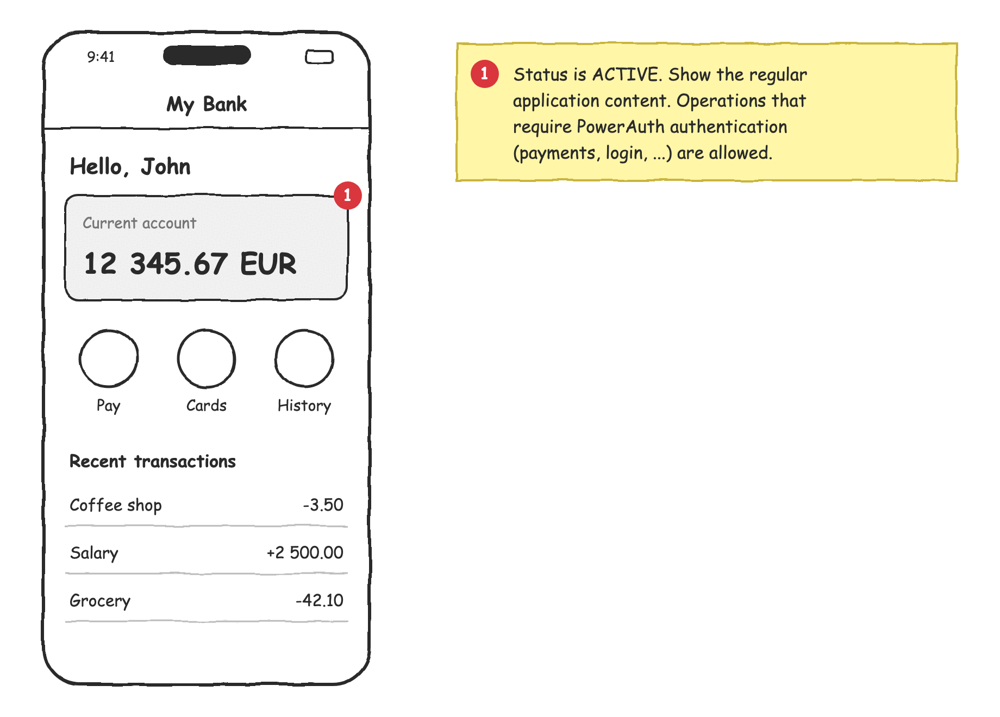
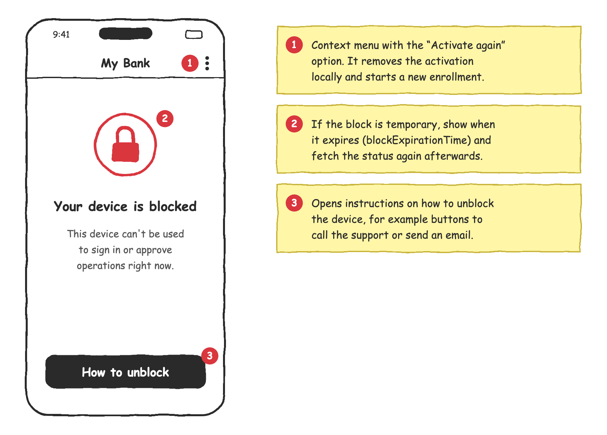
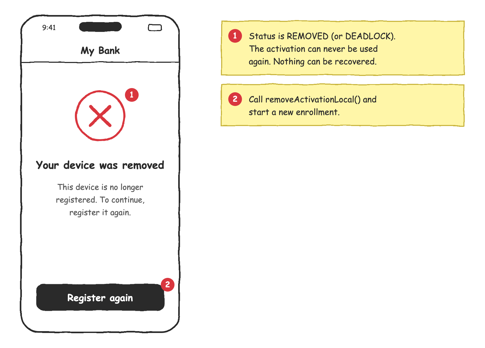
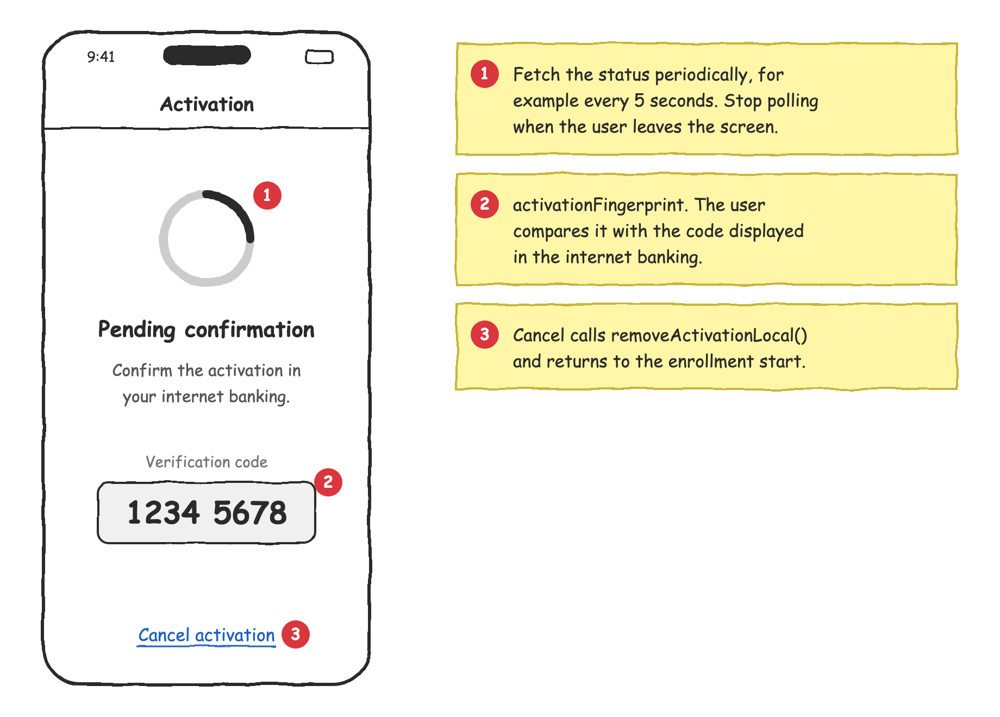

# Working With Activation Status

The activation status tells your application whether the activation on the device can still be used. The activation may change its state on the server at any time, for example, when the user blocks the device in the internet banking, or when the server blocks it after too many failed authentication attempts. This tutorial explains when to fetch the status and how to reflect it in the user interface.

<!-- begin box info -->
PowerAuth Mobile SDK **never fetches the activation status on its own**. It's up to your application to decide when to fetch it. For the full API description, see Requesting Device Activation Status on [iOS](ios/Requesting-Device-Activation-Status.md) and [Android](android/Requesting-Device-Activation-Status.md).
<!-- end -->

## Table of Contents

- [When to Fetch the Status](#when-to-fetch-the-status)
- [Reacting to the Status](#reacting-to-the-status)

## When to Fetch the Status

We recommend fetching the status in the following situations:

1. [After the application starts](#after-the-application-starts)
2. [After an authentication error](#after-an-authentication-error)
3. [When the application returns to the foreground](#when-the-application-returns-to-the-foreground)

### After the Application Starts

When the application starts, check whether there's a valid activation on the device. If there's none, start the enrollment. Otherwise, fetch the status and display the screen that matches the activation state.

<!-- begin codetabs Android iOS -->
```kotlin
fun refreshActivationStatus() {
    if (!powerAuthSDK.hasValidActivation()) {
        // No activation on the device.
        showEnrollment()
        return
    }
    powerAuthSDK.fetchActivationStatusWithCallback(context, object : IActivationStatusListener {
        override fun onActivationStatusSucceed(status: PowerAuthActivationStatus) {
            handleActivationStatus(status)
        }

        override fun onActivationStatusFailed(t: Throwable) {
            // Network or server error. Never remove the activation here,
            // just let the user try again later.
            showConnectionError()
        }
    })
}
```
```swift
func refreshActivationStatus() {
    guard powerAuthSDK.hasValidActivation() else {
        // No activation on the device.
        showEnrollment()
        return
    }
    powerAuthSDK.fetchActivationStatus { status, error in
        if let status {
            handleActivationStatus(status)
        } else {
            // Network or server error. Never remove the activation here,
            // just let the user try again later.
            showConnectionError()
        }
    }
}
```
<!-- end -->

The `handleActivationStatus()` function is described in the [Reacting to the Status](#reacting-to-the-status) chapter.

### After an Authentication Error

When an authentication fails, for example, your server responds with HTTP 401 to a request authenticated with PowerAuth, there are two possible reasons:

- The user entered a wrong PIN.
- The activation state has changed. The activation is now blocked or removed.

The status fetch tells you which one happened. If the activation is still active, the failure was caused by a wrong PIN, and you can tell the user how many attempts are left, for example, "Wrong PIN. 2 of 5 attempts left."

<!-- begin codetabs Android iOS -->
```kotlin
fun onAuthenticationFailed() {
    powerAuthSDK.fetchActivationStatusWithCallback(context, object : IActivationStatusListener {
        override fun onActivationStatusSucceed(status: PowerAuthActivationStatus) {
            if (status.state == PowerAuthActivationState.ACTIVE) {
                showWrongPin(status.remainingAttempts, status.maxFailCount)
            } else {
                // The last attempt blocked the activation, or the state changed on the server.
                handleActivationStatus(status)
            }
        }

        override fun onActivationStatusFailed(t: Throwable) {
            showConnectionError()
        }
    })
}
```
```swift
func onAuthenticationFailed() {
    powerAuthSDK.fetchActivationStatus { status, error in
        guard let status else {
            showConnectionError()
            return
        }
        if status.state == .active {
            showWrongPin(remaining: status.remainingAttempts, max: status.maxFailCount)
        } else {
            // The last attempt blocked the activation, or the state changed on the server.
            handleActivationStatus(status)
        }
    }
}
```
<!-- end -->

<!-- begin box warning -->
Never repeat the failed request with the same PIN automatically. Each attempt with a wrong PIN counts as a failed attempt, and you risk blocking the activation.
<!-- end -->

### When the Application Returns to the Foreground

The application may stay in the background for hours or days. Meanwhile, the user may block or remove the device in the internet banking, a back office operator may block it, or a temporary block may expire. Fetch the status every time the application returns to the foreground, so the user doesn't start working with an activation that no longer can be used.

<!-- begin codetabs Android iOS -->
```kotlin
class App : Application() {
    override fun onCreate() {
        super.onCreate()
        // Requires the "androidx.lifecycle:lifecycle-process" dependency.
        ProcessLifecycleOwner.get().lifecycle.addObserver(object : DefaultLifecycleObserver {
            override fun onStart(owner: LifecycleOwner) {
                // Called after the application starts and every time it returns to the foreground.
                refreshActivationStatus()
            }
        })
    }
}
```
```swift
// Don't use didBecomeActiveNotification. It's also posted after the Face ID
// prompt or a system dialog disappears.
NotificationCenter.default.addObserver(
    forName: UIApplication.willEnterForegroundNotification,
    object: nil,
    queue: .main
) { _ in
    refreshActivationStatus()
}
```
<!-- end -->

## Reacting to the Status

The following function routes the user to the screen that matches the activation state:

<!-- begin codetabs Android iOS -->
```kotlin
fun handleActivationStatus(status: PowerAuthActivationStatus) {
    when (status.state) {
        PowerAuthActivationState.ACTIVE -> showDashboard()
        PowerAuthActivationState.PENDING_COMMIT -> showPendingCommit()
        PowerAuthActivationState.BLOCKED -> showBlocked(status.blockExpirationTime)
        PowerAuthActivationState.REMOVED,
        PowerAuthActivationState.DEADLOCK -> showRemoved()
        else -> Unit
    }
}
```
```swift
func handleActivationStatus(_ status: PowerAuthActivationStatus) {
    switch status.state {
    case .active: showDashboard()
    case .pendingCommit: showPendingCommit()
    case .blocked: showBlocked(until: status.blockExpirationTime)
    case .removed, .deadlock: showRemoved()
    default: break
    }
}
```
<!-- end -->

### Active

The activation is ready to use. Show the regular application content, such as the dashboard.

<p align="center"></p>

### Blocked

The activation is blocked and can't be used right now. Show an error screen. The flow of this screen depends on your implementation:

- **Temporary block.** If the status contains `blockExpirationTime`, the activation is unblocked automatically once the time expires. See Requesting Device Activation Status on [iOS](ios/Requesting-Device-Activation-Status.md) and [Android](android/Requesting-Device-Activation-Status.md) for how to calculate the remaining time.
- **Permanent block.** The activation can be unblocked only through an external system, such as the internet banking or the back office. It depends on your business scenario. We recommend a "How to unblock" button that leads to the unblock instructions, for example, with buttons to call the support or send an email. Put the "Activate again" option to a secondary context menu. It removes the activation locally and starts a new enrollment.

<p align="center"></p>

### Removed

The activation was removed on the server, and nothing can bring it back. Show an error screen with the "Register again" button. When the user taps the button, remove the activation locally and start the enrollment again.

<p align="center"></p>

<!-- begin codetabs Android iOS -->
```kotlin
fun onRegisterAgain() {
    powerAuthSDK.removeActivationLocal(context)
    showEnrollment()
}
```
```swift
func onRegisterAgain() {
    powerAuthSDK.removeActivationLocal()
    showEnrollment()
}
```
<!-- end -->

### Deadlock

The activation is no longer able to calculate valid authentication codes, because its local counter is out of sync with the server. From the user's perspective, it's the same situation as the [removed](#removed) activation, so handle it in the same way.

### Pending Commit

This state occurs during the enrollment. The activation is created, but it's waiting for a confirmation, for example, on the website of the internet banking. Show a waiting screen with the activation fingerprint, so the user can verify that it matches the code displayed on the website. Fetch the status periodically until the state changes.

<p align="center"></p>

<!-- begin codetabs Android iOS -->
```kotlin
class PendingCommitActivity : AppCompatActivity() {
    private val handler = Handler(Looper.getMainLooper())
    private var statusTask: ICancelable? = null
    private var isPolling = false

    override fun onStart() {
        super.onStart()
        fingerprintText.text = powerAuthSDK.activationFingerprint
        isPolling = true
        fetchStatus()
    }

    override fun onStop() {
        super.onStop()
        isPolling = false
        handler.removeCallbacksAndMessages(null)
        statusTask?.cancel()
    }

    private fun fetchStatus() {
        statusTask = powerAuthSDK.fetchActivationStatusWithCallback(this, object : IActivationStatusListener {
            override fun onActivationStatusSucceed(status: PowerAuthActivationStatus) {
                if (status.state != PowerAuthActivationState.PENDING_COMMIT) {
                    handleActivationStatus(status)
                } else {
                    scheduleNextFetch()
                }
            }

            override fun onActivationStatusFailed(t: Throwable) {
                scheduleNextFetch()
            }
        })
    }

    private fun scheduleNextFetch() {
        if (isPolling) {
            handler.postDelayed({ fetchStatus() }, 5_000)
        }
    }
}
```
```swift
final class PendingCommitViewController: UIViewController {
    private var statusTask: PowerAuthOperationTask?
    private var timer: Timer?
    private var isPolling = false

    override func viewWillAppear(_ animated: Bool) {
        super.viewWillAppear(animated)
        fingerprintLabel.text = powerAuthSDK.activationFingerprint
        isPolling = true
        fetchStatus()
    }

    override func viewWillDisappear(_ animated: Bool) {
        super.viewWillDisappear(animated)
        isPolling = false
        timer?.invalidate()
        statusTask?.cancel()
    }

    private func fetchStatus() {
        statusTask = powerAuthSDK.fetchActivationStatus { [weak self] status, error in
            guard let self, isPolling else { return }
            if let status, status.state != .pendingCommit {
                handleActivationStatus(status)
            } else {
                timer = Timer.scheduledTimer(withTimeInterval: 5, repeats: false) { [weak self] _ in
                    self?.fetchStatus()
                }
            }
        }
    }
}
```
<!-- end -->

If the user cancels the activation on this screen, call `removeActivationLocal()` and return to the beginning of the enrollment.
